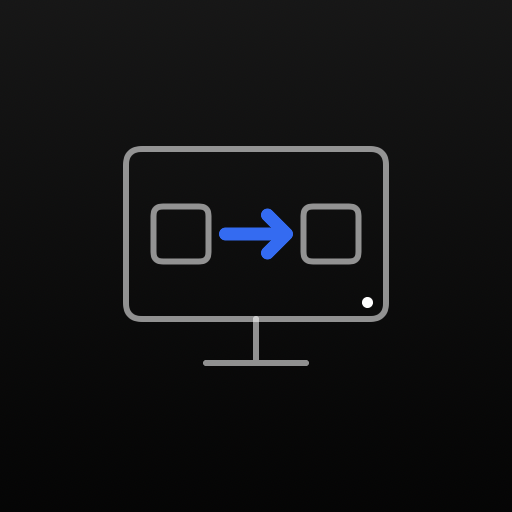

# monitor-switch

A small self-hosted web app that switches a monitor's input source over
DDC/CI. Run it on any always-on Linux machine connected to the monitor, then
switch inputs from a browser, a dashboard, or the native iPhone app in
[`ios/`](ios).

<p align="center"></p>

> [!IMPORTANT]
> This was built for and tested on **one specific monitor: the LG UltraFine
> 27US500-W**, with an Intel iGPU on the server. The default
> [`config.json`](config.json) holds that monitor's values. Other monitors
> (including other LG models) may need different commands or values; see
> [Adapting to another monitor](#adapting-to-another-monitor).

## How it works

```
iPhone / browser / dashboard ──HTTPS──▶ monitor-switch (Bun, Docker) ──ddcutil──▶ monitor (DDC/CI over HDMI/DP)
```

The Linux host only needs one video cable to the monitor. Most monitors keep
accepting DDC/CI commands on an input that is not currently displayed, so the
host can switch the monitor to any source, including away from itself and back.

My setup:

| Button  | Port        | Device                     |
|---------|-------------|----------------------------|
| desktop | HDMI 1      | Desktop (gaming PC)        |
| server  | HDMI 2      | Server (runs this)         |
| macbook | DisplayPort | MacBook                    |

### LG 27US500-W quirk

This monitor ignores the standard *Input Source* command (VCP `0x60`): the
screen blanks for a moment and then returns to the previous input. It only
switches with LG's vendor command, VCP `0xF4` sent with I2C source address
`0x50`:

```sh
ddcutil --i2c-source-addr=x50 setvcp xf4 0x0090   # HDMI 1
ddcutil --i2c-source-addr=x50 setvcp xf4 0x0091   # HDMI 2
ddcutil --i2c-source-addr=x50 setvcp xf4 0x00d0   # DisplayPort
```

The monitor also does not report its current input, so the UI shows which
input was **last sent** from that device, not the live state.

## Requirements

- A Linux host with a GPU output connected to the monitor, exposing
  `/dev/i2c-*` (Intel, AMD and most NVIDIA drivers do).
- Docker with Compose.
- DDC/CI enabled in the monitor's on-screen menu (it usually is by default).

## Install

1. **Load the I2C driver** on the host, now and at boot:

   ```sh
   echo i2c-dev | sudo tee /etc/modules-load.d/i2c-dev.conf
   sudo modprobe i2c-dev
   ```

2. **Check that the monitor answers** (install `ddcutil` on the host for this
   step only):

   ```sh
   sudo apt install ddcutil
   sudo ddcutil detect          # note the /dev/i2c-N bus of your monitor
   ```

3. **Clone and configure:**

   ```sh
   git clone https://github.com/example/monitor-switch.git
   cd monitor-switch
   cp .env.example .env
   ```

   Edit [`config.json`](config.json) for your monitor and devices, and the
   `devices:` list in [`docker-compose.yml`](docker-compose.yml) if your
   buses differ. Set `I2C_GID` in `.env` if `getent group i2c` is not `107`.

4. **Start it:**

   ```sh
   docker compose up -d --build
   curl http://localhost:7580/api/health   # {"ok":true}
   ```

5. **Put it behind HTTPS** with your reverse proxy (Nginx Proxy Manager,
   Caddy, Traefik…) and keep it on your home network or VPN. There is no
   authentication: anyone who can reach it can switch your monitor, so do
   not expose it to the internet.

## Use

### Browser and dashboards

Open the URL and tap an input.

To embed the page in a dashboard such as Homarr (iframe widget), allow the
dashboard's origin in `.env`:

```sh
FRAME_ANCESTORS='self' https://homarr.example.com
```

A plain app/link tile to the URL works without this.

### Languages

The web UI and the iPhone app are in English by default, with Brazilian
Portuguese as an option: the **EN / PT** switch in the web header, or
Settings > Language in the app. The choice is remembered on that device. Web
strings live in [`public/i18n.js`](public/i18n.js); app strings in
`ios/MonitorSwitch/Localizable.xcstrings`.

### iPhone app

[`ios/`](ios) holds a native SwiftUI app with the same Rosé Pine look as the
web UI. It reads the inputs from
`/api/config`, so it needs no changes when you edit `config.json`. It is not
on the App Store; build it yourself with Xcode:

1. Requirements: a macbook with Xcode 16 or later, an iPhone on iOS 17 or later,
   and an Apple ID signed in under Xcode > Settings > Accounts (a free account
   works, but its builds expire after 7 days).
2. Set your signing team and a bundle id prefix:

   ```sh
   cd ios
   cp Local.xcconfig.example Local.xcconfig   # then edit both values
   ```

3. Open `ios/MonitorSwitch.xcodeproj`, pick your iPhone as the run
   destination, and press Run. The first time, allow the developer profile on
   the phone under Settings > General > VPN & Device Management.
4. In the app, enter your server URL (for example
   `https://monitor-switch.example.com` or `http://192.168.1.10:7580`).

Tap an input to switch; pull down to reload the input list. Like the web
UI, the app shows the input last sent from that phone. Plain `http://` is
allowed only for local network addresses.

Without Xcode, you can still use the web UI as a home-screen app: open the URL
in Safari, then Share > **Add to Home Screen**.

For a development-signed IPA, the embedded provisioning profile must include
your iPhone and must not have expired. To install without signing it again,
unzip the IPA and drag `Payload/MonitorSwitch.app` into Xcode's Devices and
Simulators window for your connected iPhone. Rebuild with Xcode to renew a
free account's seven-day profile. When updating an installation made with
Sideloadly, keep its installed bundle identifier (which may have a team suffix)
to preserve app data and avoid using another free-account app slot.

Sideloadly error `7252` (certificate not found on the team) concerns its Apple
signing request; changing the IPA's bundle identifier does not fix that request.
An already signed build can instead be installed directly through Xcode.

For Siri, widgets or the Action button, create a Shortcut with **Get Contents
of URL**: method `POST`, URL `https://<host>/api/input/<id>`.

### API

| Method | Path               | Description                          |
|--------|--------------------|--------------------------------------|
| `GET`  | `/api/health`      | `{"ok":true}`                        |
| `GET`  | `/api/config`      | Monitor name and input labels        |
| `POST` | `/api/input/{id}`  | Switch to the input with that `id`   |

```sh
curl -X POST https://<host>/api/input/macbook
```

Every switch request is logged to stdout as JSON (time, client IP, input,
result): `docker logs monitor-switch`.

## Adapting to another monitor

[`config.json`](config.json):

| Field           | Meaning                                                        |
|-----------------|----------------------------------------------------------------|
| `monitor`       | Display name shown in the UI                                   |
| `vcp`           | VCP feature code: `x60` (standard) or `xf4` (LG vendor)        |
| `i2cSourceAddr` | Optional. `x50` for LG's vendor command; omit for standard     |
| `inputs[].id`   | Used in the API path                                           |
| `inputs[].label`, `port` | Text in the UI                                        |
| `inputs[].value`| Value sent with `setvcp`                                       |
| `inputs[].icon` | `desktop`, `laptop`, `server`, `tv` or `console`               |

Most monitors use the standard command. Try it on the host first:

```sh
sudo ddcutil capabilities | grep -A10 "Feature: 60"   # lists supported inputs
sudo ddcutil setvcp 60 0x11                            # e.g. HDMI 1
```

Common standard values: DisplayPort 1 `0x0f`, DisplayPort 2 `0x10`,
HDMI 1 `0x11`, HDMI 2 `0x12`. If the screen only blinks and returns (as on
the 27US500-W), try LG's vendor command with values DisplayPort 1 `0x00d0`,
DisplayPort 2 `0x00d1`, HDMI 1 `0x0090`, HDMI 2 `0x0091`, USB-C `0x00d2`.

## Fallback

If the host is down, use the monitor's buttons. On an Apple Silicon Mac,
[`m1ddc`](https://github.com/waydabber/m1ddc) can switch too:
`m1ddc set input-alt 144|145|208` (LG: HDMI 1, HDMI 2, DisplayPort) or
`m1ddc set input 17|18|15` (standard).

## Privacy

Single-user, self-hosted tool. It sets no cookies and collects no personal
data. The last-sent input and the language choice are kept in the browser's
local storage (or, in the iPhone app, on the phone with the server URL). The app has no analytics and
talks only to the server you enter. Server logs contain client IP addresses
and are subject to Docker's log retention.

## License

[MIT](LICENSE). `ddcutil` (GPL-2.0) is installed in the container from
Debian and run as a separate program; it is not part of this code.
